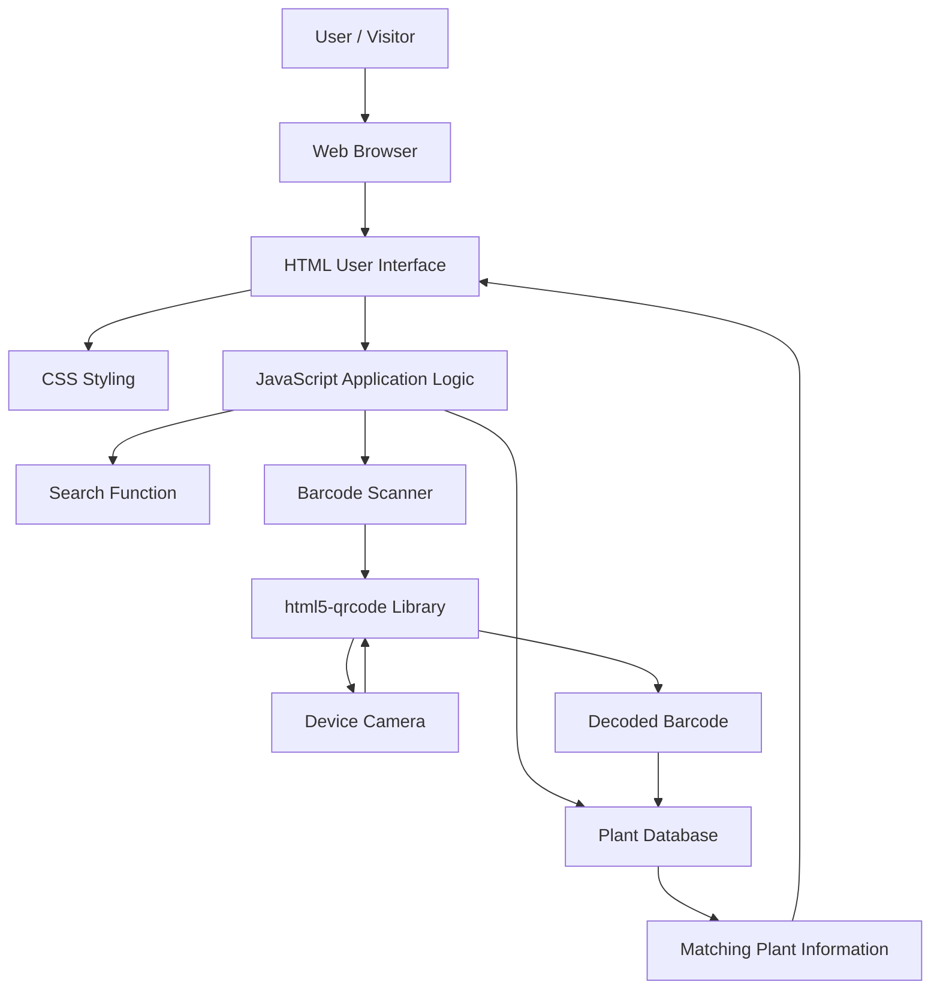
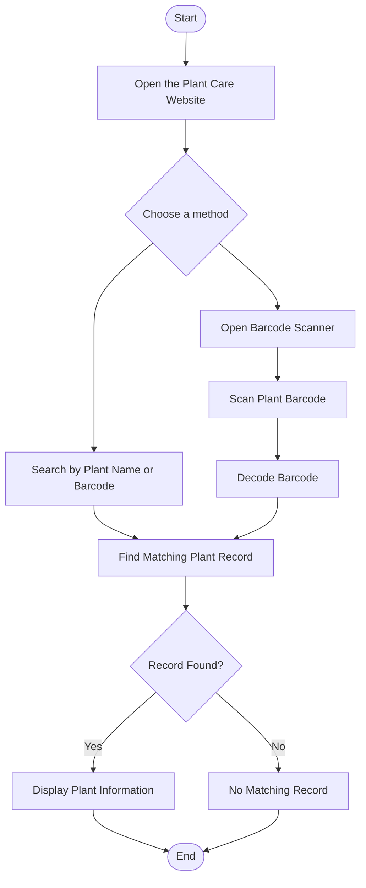
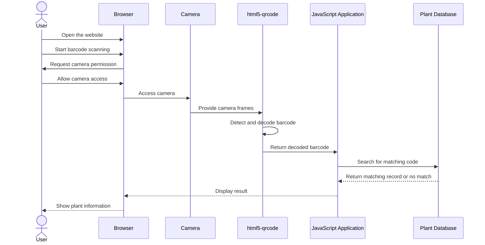

# 🌿 TM Zierpflanzen – Plant Care Tips & Barcode Scanner

A web-based plant care application that helps users quickly find information about ornamental plants. The website provides plant care tips, plant information, a search function, and a camera-based barcode scanner that identifies plants using their associated EAN-13 codes.

The project is built with HTML, CSS, and JavaScript and can be hosted as a static website using GitHub Pages.

---

## 📌 Table of Contents

1. [Project Overview](#-project-overview)
2. [Objectives](#-objectives)
3. [Features](#-features)
4. [Plant Database](#-plant-database)
5. [System Architecture](#-system-architecture)
6. [Application Workflow](#-application-workflow)
7. [Barcode Scanning Workflow](#-barcode-scanning-workflow)
8. [Technologies Used](#-technologies-used)
9. [Project Structure](#-project-structure)
10. [Installation and Setup](#-installation-and-setup)
11. [Deployment with GitHub Pages](#-deployment-with-github-pages)
12. [How to Use the Website](#-how-to-use-the-website)
13. [Requirements and Limitations](#-requirements-and-limitations)
14. [Future Improvements](#-future-improvements)
15. [Contributing](#-contributing)
16. [License](#-license)

---

## 🌱 Project Overview

**TM Zierpflanzen** is a digital plant information and care website designed to make ornamental plant care information easy to access.

Users can browse plant information, search for a plant by name or barcode number, and use a compatible device's camera to scan a barcode. When a scanned barcode matches an entry in the website's plant database, the corresponding plant information is displayed.

The project combines a simple web interface with barcode recognition to provide a convenient way to access plant care information without manually searching through a list.

The website is designed as a static web application. Plant information is stored in JavaScript, while HTML defines the page structure and CSS controls the appearance.

### Why this project?

Plant labels can contain limited information, and manually finding the correct care instructions can be inconvenient. This application connects a barcode with a corresponding plant record, making the information easier to find.

## 🎯 Objectives

The main objectives of this project are:

- Provide an accessible digital collection of ornamental plant care information.
- Allow users to search for plants quickly.
- Connect barcode numbers to the correct plant records.
- Support camera-based barcode scanning on compatible devices.
- Display plant information through a user-friendly interface.
- Make the website accessible online using GitHub Pages.
- Keep the application simple to maintain and extend.

---

## ✨ Features

### 1. Plant information

The website contains records for ornamental plants. Each record is associated with a plant name and a barcode number, along with the plant information provided by the application.

### 2. Search functionality

Users can search the available plant records using supported search terms, including plant names and barcode numbers.

### 3. Barcode scanner

The application uses the `html5-qrcode` JavaScript library to support camera-based barcode scanning.

The intended workflow is to scan a plant label and use the decoded barcode to find the matching record.

### 4. Automatic plant lookup

When a scanned code matches a barcode in the plant database, the corresponding plant information is opened.

If no matching record exists, the application cannot identify the plant from its current database.

### 5. Responsive browser-based access

The application runs in a web browser and does not require a separate mobile app installation.

### 6. Static website hosting

The website can be published through GitHub Pages without requiring a dedicated application server or database.

---

## 🌼 Plant Database

The current application contains the following ten plant entries:

| No. | Plant name | Barcode (EAN-13) |
|---:|---|---|
| 1 | Leberbalsam | `2000000000015` |
| 2 | Windröschen | `2000000000022` |
| 3 | Löwenmaul | `2000000000039` |
| 4 | Zierspargel | `2000000000046` |
| 5 | Glattblatt-Aster | `2000000000053` |
| 6 | Prachtspiere | `2000000000060` |
| 7 | Goldtaler | `2000000000077` |
| 8 | Schneeflockenblume | `2000000000084` |
| 9 | Zimmerbegonie | `2000000000091` |
| 10 | Eisbegonie, Kirschblüten | `2000000000107` |

**Note:** These are the barcode values configured in this project. They are used as identifiers within the application's own plant database; they should not be assumed to be globally registered retail product codes.

---

## 🏗️ System Architecture

The application has three main parts:

- **User interface:** HTML and CSS display the website, search controls, scanner interface, and plant information.
- **Application logic:** JavaScript handles searching, barcode lookup, and displaying the matching plant record.
- **Barcode recognition:** The `html5-qrcode` library accesses a supported camera and decodes compatible barcodes.



The browser runs the application locally after loading the website files and required external resources. GitHub Pages provides the files to visitors; it does not itself perform the barcode lookup.

---

## 🔄 Application Workflow

The website supports two main ways of finding a plant: searching manually or scanning its barcode.



### Workflow explanation

1. The user opens the website.
2. The user searches for a plant or starts the barcode scanner.
3. The application obtains a search term or decoded barcode.
4. JavaScript compares the value against the configured plant records.
5. If a match is found, the corresponding plant information is displayed.
6. If there is no match, the code does not identify a plant in the current database.

---

## 📷 Barcode Scanning Workflow

The scanner is designed to connect a physical plant label to the corresponding record in the website.



### Important scanning conditions

- The user must grant camera permission.
- The browser and device must support the required camera APIs.
- Camera access normally requires HTTPS, except for certain local development contexts.
- The barcode must be readable and supported by the configured scanner.
- The decoded number must match a record in the plant database.
- The scanner library must load successfully.

---

## 🛠️ Technologies Used

| Technology | Purpose |
|---|---|
| HTML5 | Website structure and content |
| CSS3 | Layout, styling, and presentation |
| JavaScript | Search, barcode lookup, and interface interactions |
| `html5-qrcode` | Camera-based barcode recognition |
| Browser Media APIs | Camera access on supported devices |
| Git and GitHub | Source code management |
| GitHub Pages | Static website hosting |

### How the technologies work together

HTML provides the page elements, CSS makes the interface readable and usable, and JavaScript connects user actions with the plant records. The barcode library processes camera input and provides decoded barcode values to the application.

---

## 📁 Project Structure

A simple repository for publishing the current website can look like this:

```text
zierpflanzen/
│
├── index.html
├── README.md
└── assets/                 # Optional additional local assets
```

If you keep the file under the name `pflegetipps.html`, the structure can instead be:

```text
zierpflanzen/
│
├── pflegetipps.html
├── README.md
└── assets/                 # Optional additional local assets
```

**Important:** GitHub Pages can serve either filename, but the root website URL normally opens `index.html` automatically. If you want the main URL to open the plant care website directly, upload the prepared website as `index.html`, or create an `index.html` entry point that links to `pflegetipps.html`.

The current website also loads the barcode scanner library from an external CDN. If you add local JavaScript, CSS, or image files later, keep their paths consistent with the repository structure.

---

## 🚀 Installation and Setup

### Option 1: Open the website locally

1. Download the website HTML file.
2. Keep the filename as `pflegetipps.html` or rename it to `index.html` if appropriate.
3. Open the file in a modern browser to inspect the interface.
4. For reliable camera testing, serve the website through a local development server or HTTPS rather than relying on direct file access.
5. Ensure an internet connection is available when the application depends on the external scanner library or hosted images.

### Option 2: Use GitHub

1. Create a repository on GitHub.
2. Upload the website HTML file.
3. Add this README as `README.md`.
4. Commit your changes.
5. Configure GitHub Pages to publish the repository.

---

## 🌐 Deployment with GitHub Pages

GitHub Pages allows this static website to be published online.

### Step 1: Create a repository

Create a repository such as `zierpflanzen`.

For a straightforward public GitHub Pages setup, select **Public** visibility.

### Step 2: Upload the website

Upload the prepared HTML file to the repository's root directory.

For the simplest setup, name the main page `index.html`.

### Step 3: Add the README

Create or edit `README.md` and paste in this documentation.

### Step 4: Enable GitHub Pages

1. Open the repository's **Settings**.
2. Select **Pages**.
3. Under **Build and deployment**, choose **Deploy from a branch**.
4. Select the `main` branch.
5. Select the `/(root)` folder.
6. Click **Save**.

### Step 5: Open the published website

The project site normally follows this URL format:

```text
https://YOUR-USERNAME.github.io/zierpflanzen/
```

Replace `YOUR-USERNAME` with your GitHub username and `zierpflanzen` with your repository name.

GitHub Pages may take a few minutes to publish the first version.

Official documentation: https://docs.github.com/en/pages/getting-started-with-github-pages/creating-a-github-pages-site

---

## 🧭 How to Use the Website

### Searching for a plant

1. Open the plant care website.
2. Find the search field.
3. Enter a supported plant name or barcode.
4. Review the matching plant record.
5. Open the plant information to view the available details.

### Scanning a barcode

1. Open the website on a device with a camera.
2. Select the barcode scanner.
3. Allow camera access when prompted.
4. Position the barcode clearly in the camera view.
5. Wait for the scanner to decode the code.
6. If the decoded value matches a plant record, review the displayed information.

### If a barcode does not work

- Check that camera permission has been granted.
- Ensure the barcode is visible, well-lit, and in focus.
- Confirm that the scanner library loaded successfully.
- Check whether the scanned number exists in the plant database.
- Verify that the website is being accessed through HTTPS when deployed.

---

## ⚠️ Requirements and Limitations

### Internet access

The current setup loads the barcode scanner library from an external CDN and uses externally hosted images. These resources may not load without an internet connection.

### Camera permissions

Camera scanning requires browser permission and a supported device. Some browser or device configurations may prevent access.

### Database scope

The application can identify only the plant records configured in its code. It does not automatically identify every plant or search a global plant database.

### Barcode accuracy

A barcode identifies a record only when the decoded value matches the application's stored code. A barcode alone does not verify a plant's biological identity.

### Static hosting

GitHub Pages serves static files. The current architecture does not require a backend server or a separate database service, but changes to plant records generally require updating the website code and publishing the update.

---

## 🔮 Future Improvements

The following ideas could extend the project beyond its current functionality.

### Plant information

- Add more ornamental plant species.
- Include structured details for light, watering, soil, temperature, and flowering.
- Add plant photographs and clearer care summaries.
- Support filtering by plant characteristics.

### Barcode scanner

- Add clearer feedback for invalid or unknown codes.
- Improve scanner start, stop, and retry controls.
- Provide a manual barcode entry option if camera access is unavailable.
- Improve error messages for permission and loading failures.

### Data management

- Move plant records into a separate JSON file.
- Add a more convenient way to maintain the plant database.
- Validate barcode values and prevent duplicate entries.
- Consider a backend database if the project grows substantially.

### User experience

- Improve accessibility and mobile usability.
- Add a multilingual interface.
- Add favorites or a personal plant collection.
- Offer optional watering reminders or care schedules.

These are potential improvements and are not all implemented in the current version.

---

## 🤝 Contributing

Contributions and suggestions are welcome.

A suggested contribution process:

1. Fork the repository.
2. Create a branch for your changes.
3. Make and test your updates.
4. Commit your changes with a descriptive message.
5. Open a pull request explaining what you changed.

When adding a plant, ensure that its barcode is unique within the application's records and that the corresponding plant information is complete.

---

## 📄 License

No license is currently specified for this project. Unless a license is added, others should not assume that they have permission to reuse, modify, or redistribute the project's code.

If you intend to make the project open source, choose and add an appropriate license.

---

## 🌿 Project Summary

**TM Zierpflanzen** is a browser-based ornamental plant care website that combines searchable plant information with barcode-assisted lookup. Its simple HTML, CSS, and JavaScript architecture makes it suitable for static hosting and future development.

The main workflow is straightforward:

**Search or scan → Match the barcode → Display plant information.**

The project provides a foundation for making ornamental plant care information easier to access and for adding more plant records and features over time.
